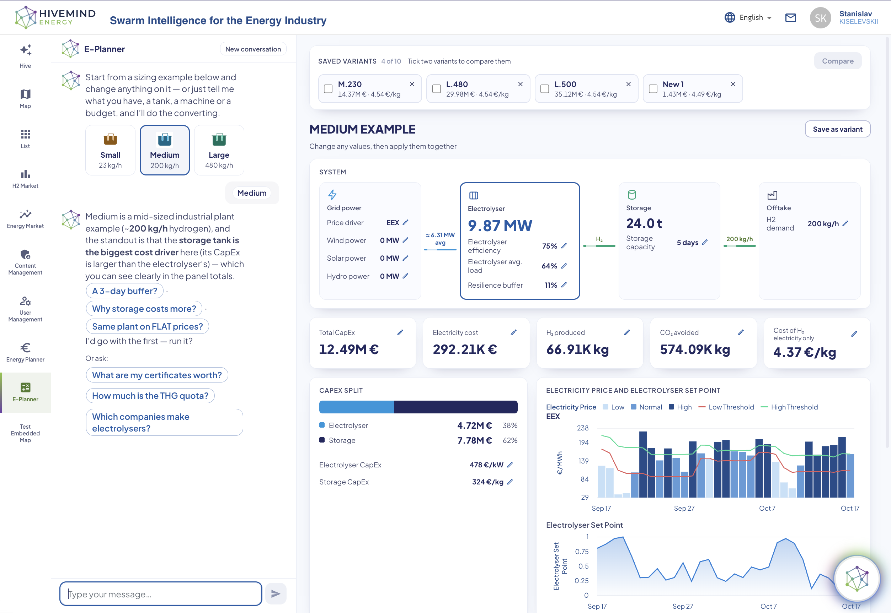
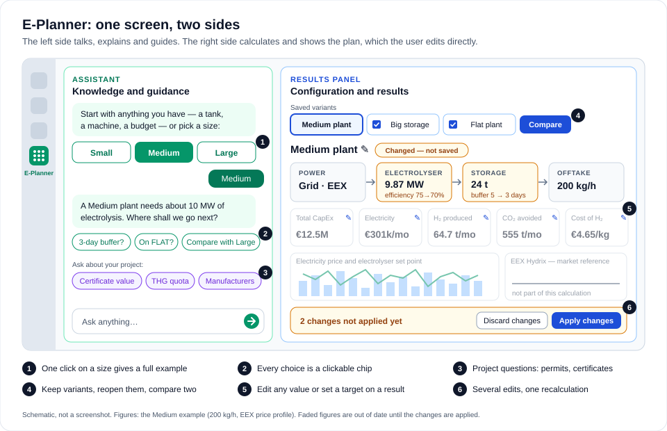
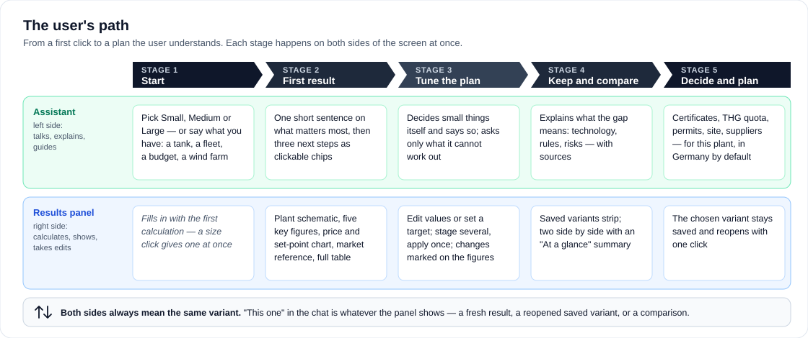
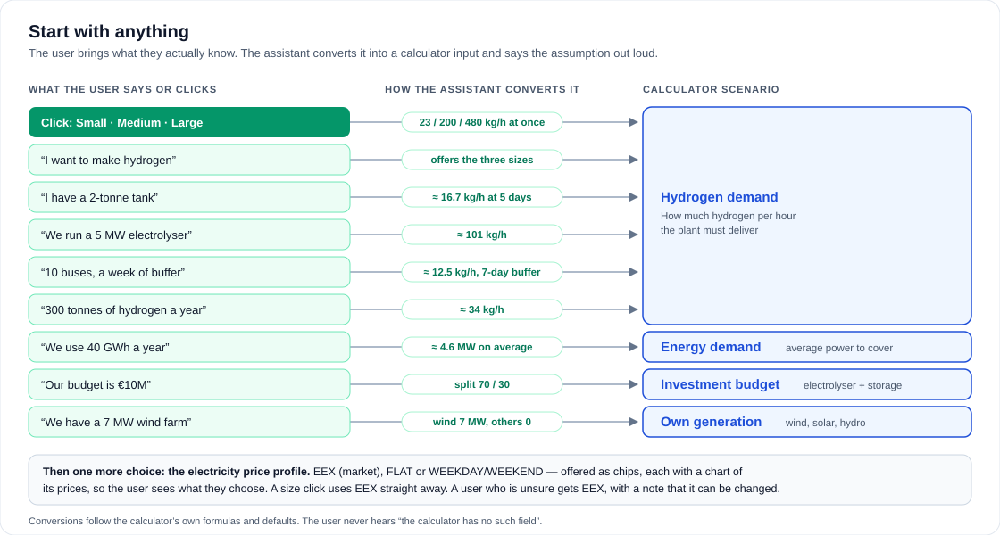
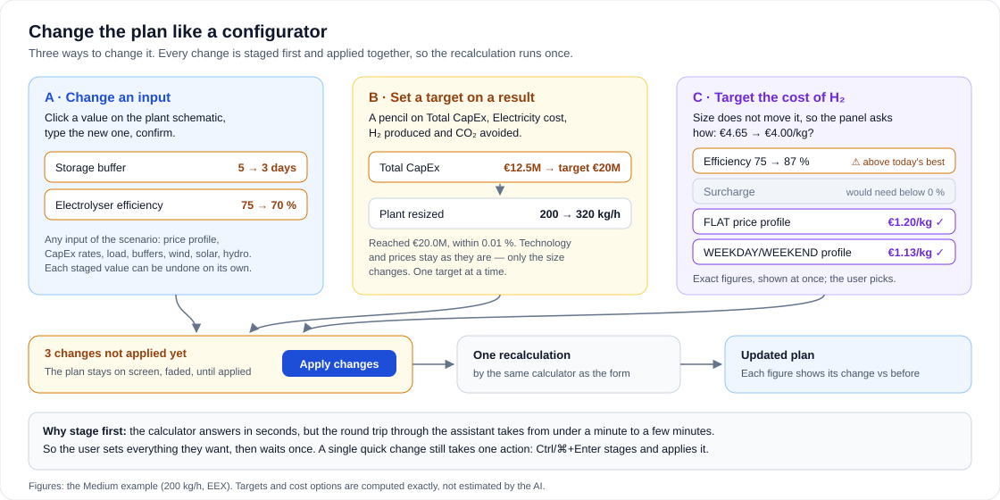
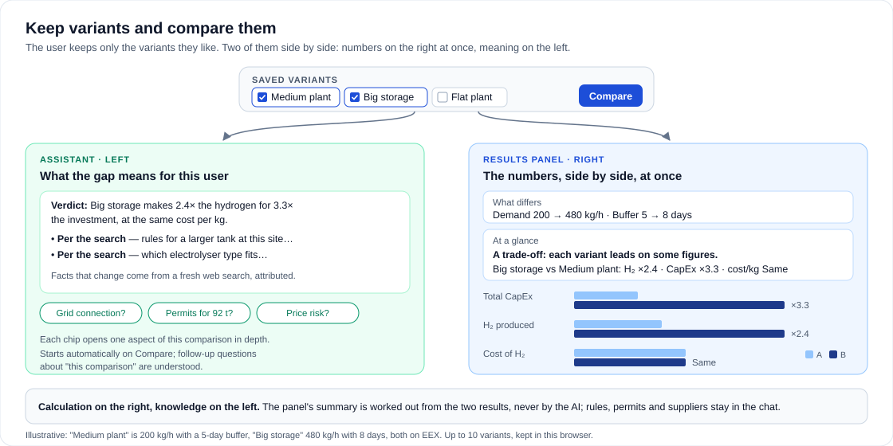

# E-Planner — An AI-Guided Planner for Hydrogen Production Facilities

[Back to the main page](../../README.md)

**Development period:** 2026.09-2026.10

**Categories:** [Job](../EmploymentBasedProjects.md)

**Practical application:** Helping people who are new to hydrogen plan their own production facility — from the first click to a costed, comparable set of variants[^1].

## The Problem

The platform already had a good calculator for the sizing and costing of a hydrogen production facility. It was a form. You had to know which scenario to choose, which fields to fill and what the numbers meant.

That is fine for an expert. For someone who just owns a wind farm, or runs a fleet of hydrogen trucks, or simply thinks "maybe I should make hydrogen", it is a wall. Such a user rarely knows the right question, so they cannot get the right answer.

My task was to lower this entry barrier. The user should feel comfortable from the first click, and the product should lead them step by step to a solution of their own problem — without losing a single bit of the calculator's precision.

## What I Built

**Fig. 0** — E-Planner in action. The user clicked "Medium"; the assistant explains that the storage tank is the biggest cost driver and offers the next steps as chips. On the right: saved variants, the plant schematic with editable inputs, the five key figures, the CapEx split and the electricity price with the electrolyser's set point.

### One Screen, Two Areas of Attention

I split the screen into two areas, each with its own focus:

- **the conversation** on the left: a free-form dialogue with an AI consultant;
- **the model** on the right: the future facility as a live plan, from power through the electrolyser and the storage to the offtake.

**Fig. 1** — The E-Planner screen. The assistant guides on the left; the plan lives on the right. Both sides always refer to the same variant, so when the user says "this one", the assistant knows what they mean.

Free form does not mean passive. The assistant takes an active part in the dialogue: it gives hints, anticipates what the user most likely needs at the current step, and ends every reply with a concrete next move. "Ok" or "yes" is enough to go ahead.

**Fig. 2** — The user's path. Every stage happens on both sides of the screen at once.

### Less Typing, More Clicking

I paid particular attention to keeping manual text input to a minimum.

- **A start with no form to fill.** One click on Small, Medium or Large (the platform's standard 23, 200 and 480 kg of hydrogen per hour) gives a complete plan at once.
- **Start from what you have.** A tank, an electrolyser, a vehicle fleet, a budget or a wind farm is converted into calculator input. The assistant states the assumption it made, for example "at the usual five-day buffer". The user never hears "the calculator has no such field".
- **Every choice is a clickable chip.** After each result, the assistant offers three next steps that fit the conversation.
- **Short replies.** About 50 words. The figures are on the panel, not in the text.

**Fig. 3** — Any starting point leads into one of the calculator's four scenarios: hydrogen demand, energy demand, investment budget or own generation.

### A Plan You Can Edit Like a Configurator

The right side is not a report. It is a configurator.

- **In-place editing.** Any input can be changed directly on the plant schematic. Several edits are staged and applied with a single recalculation. Until then, the old figures stay on screen, faded and marked as out of date; afterwards, every figure shows how it changed.
- **Targets on results.** The user says, "I want a total CapEx of €20M", and the plant is resized to reach it, while technology and prices stay unchanged.
- **Honest answers about levers.** The cost of hydrogen per kilogram does not depend on the plant size. So, when the user sets a target on it, the panel shows what really moves it — efficiency, the electricity surcharge, a different price profile — each with its exact figure. Options that cannot reach the target are marked as such.

**Fig. 4** — Editing the plan: staged changes, one recalculation, every difference visible.

### Variants and Comparison

The user keeps the variants they like (up to ten), names them and reopens any of them with one click. Any two can be compared, and the comparison works in two senses:

- **quantitative** — the panel shows what differs, figure by figure, with an "At a glance" summary computed from the two results;
- **qualitative** — the assistant explains what the difference means for this user: technology, regulations and risks, based on a fresh web search.

**Fig. 5** — Two variants side by side: numbers on the panel, meaning in the chat.

### Help Beyond the Calculation

Planning a facility is more than sizing it. The assistant also answers the questions that come next: the value of certificates and the THG quota, TÜV certification, permits and safety distances, electrolyser manufacturers, how to get started at all. If the answer depends on the site, it asks where the plant will stand and gives an honest first assessment — including "practically impossible" where that is the case.

It also asks the questions a good consultant would ask: do you have a contract to sell electricity? Do you have surplus power? Should I check your settings?

## Why the Figures Can Be Trusted

This was the central design decision of the whole project.

- **The calculator is the only source of plan figures.** E-Planner reaches the existing Sizing & Costing calculator through new entry points of its own. For all four scenarios, its figures were checked against the form's reference values and matched.
- **The AI does no arithmetic that matters.** Resizing to a target, the cost-of-H₂ options, yearly totals and comparison ratios are computed in code. Targets are reached to within 0.01 %.
- **Facts that change are looked up, not remembered.** Regulations, quotas, permit procedures and suppliers come from a search at the moment of the question, and the reply says so. If no search ran, the reply says the fact is unchecked.

## Key Facts

| Aspect | Result |
| --- | --- |
| Calculator scenarios | All four: hydrogen demand, energy demand, investment budget, own generation |
| Source of plan figures | Only the existing calculator; the AI does no arithmetic that matters |
| Accuracy | Matched the form's reference values in all four scenarios; targets reached to within 0.01 % |
| Key figures on the panel | Total CapEx, electricity cost, hydrogen produced, CO₂ avoided, cost of H₂ per kg |
| Saved variants | Up to ten, compared two at a time |
| Languages | English, German and French, always in the formal register (Sie, vous) |
| Impact on existing features | None: the form, its formulas and the existing chat work as before |

## What I Learned

This project gave me practical experience in building a product where an AI assistant sits between a mathematical calculation and the user interface. Three lessons stand out:

- **Keep the numbers away from the language model.** The calculator and the code compute; the AI explains, guides and words the answer. This is what makes the figures trustworthy.
- **Facts that change must be looked up, not remembered.** A model's memory is frozen; regulations are not.
- **A guide is more useful than an answering machine.** A user who is new to a subject rarely knows the right question. An assistant that proposes the next step keeps them moving.

And one more thing, more personal. In my own projects, I set the task myself and decide myself whether it has been achieved. Here, I did neither. The task came from the customer, and the customer judged the result. That is exactly what gave this project its value for me.

## Technical Details

**Architecture:** A new section of an existing web platform (Node, MS Azure AI). A chat-based AI assistant drives the existing Sizing & Costing calculator through dedicated entry points; all derived figures (targets, levers, comparisons) are computed in code; web search supplies time-sensitive facts.

**Integration:** Shares the platform's design system. The existing form, its formulas, its report and the existing chat were left untouched.

**Current status:** Feature-complete, handed over for code review and merge (October 2026).

[^1]: Developed as a new module of a hydrogen industry platform, on top of its existing Sizing & Costing calculator.
